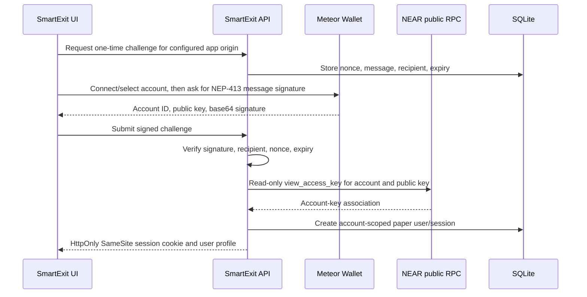

# SmartExit architecture

## Overview

SmartExit is a local multi-account paper-trading application. NEAR wallet ownership is verified using a one-time signed message; the Express API reports its configured network to the web client and verifies access keys against that network's public RPC (`testnet` by default, configurable with `NEAR_NETWORK`). The API owns sessions, account-scoped validation/risk checks, position transitions, and SQLite writes. Binance connectivity is limited to public read-only market data; live orders and wallet transactions are not supported.

```text
React + Vite (127.0.0.1:5173)
        | /api proxy
Express + TypeScript (localhost:3001)
        |                     \-- NEAR wallet selector → Meteor Wallet (NEP-413 message signature)
        |                     \-- Public NEAR RPC (read-only access-key ownership check)
        |                     \-- Binance public REST + all-symbol futures WebSocket/REST price fallback
Node built-in node:sqlite / SQLite file
        |
data/smartexit.sqlite (local, gitignored)
```

### NEAR sign-in boundary



The signature proves control of a registered key; it does not authorize or send a transaction. The cookie contains a random session token while SQLite stores only its SHA-256 hash. Expired challenges are removed when issuing a challenge; expired sessions are removed on that same sign-in path and are rejected on every authentication check. NEAR auth endpoints are rate-limited per client IP. Authenticated state-changing requests require an allowed `Origin`; production requires an explicit HTTPS `APP_ORIGIN`. Trust-proxy settings remain unset by default and must be configured deliberately if deployed behind a proxy.

The stack follows the requested lightweight Windows/npm setup. Node 22.5+ supplies `node:sqlite`, avoiding a native SQLite dependency and Docker. No browser state is authoritative.

## Persistence

The API applies versioned schema migrations using SQLite `PRAGMA user_version`. Tables store wallet users, hashed expiring sessions, one-time challenges, account-owned trades/events, account risk settings, and per-asset paper balances. WAL mode, foreign keys, unique event keys, parameterized statements, and `BEGIN IMMEDIATE` transactions protect local writes.

Trade price updates check idempotency, load the current account-owned state, calculate all transitions, update the trade, append milestone/exit audit events, and update account P&L in a transaction. User sessions are stored as SHA-256 token hashes and sent to the browser as HttpOnly SameSite cookies. Duplicate manual event IDs return current state without repeating P&L.

Startup restores open positions and risk settings from SQLite; restart is not a close event. Persisted trade rows are checked for invalid numeric fields and status values; suspicious rows receive a one-time `DATA_RECOVERY_WARNING` event and are not silently rewritten or closed.

## Trade-state rules

LONG targets are strictly ordered `initial stop < entry < TP1 < TP2 < TP3`. SHORT targets are strictly ordered in reverse. TP1 activates a trailing stop, TP2 changes the milestone state, and TP3 closes the full quantity. Before TP1, the initial stop closes the full quantity. Once trailing is active, its stop only moves in the protective direction. Terminal states cannot receive further price updates.

Manual price submissions carry a caller-supplied UUID event ID. Public Binance all-symbol WebSocket tickers update prices about once per second while the app is open; if the socket is unavailable, the browser polls the all-symbol price REST endpoint once per second. These prices feed the same paper state machine and may simulate TP/stop exits; they are not exchange fills. If a protective stop and target both trigger on one update, the stop is processed first.

Simplified P&L is `(exit/current - entry) × quantity` for LONG and `(entry - exit/current) × quantity` for SHORT. Fees, funding, slippage, liquidation, and contract multipliers are excluded.

## Risk Guardian

Defaults are paper equity `$10,000`, at most three open positions, at most 1% equity risk per trade, and a 3% loss limit based on starting UTC-day paper equity. Estimated trade risk is `abs(entry - initial stop) × quantity`. Limits are enforced in the API before a new row is created. The daily block stays active for the remainder of the UTC day once reached.

The kill switch blocks new positions and pauses automatic paper-price processing for that account. It is retained in SQLite and never deletes trades or events. Realtime paper updates pause if the live feed disconnects.

Cancelling an open paper position closes the entire simulated quantity at its last submitted price, computes simplified realized P&L, and appends a cancellation event. It does not imply a live order cancellation.

## NEAR Intents

`near-intents-adapter.ts` is an isolated honest placeholder. The official [1Click API quickstart](https://docs.near-intents.org/integration/distribution-channels/1click-api/quickstart/introduction) states that NEAR Intents has no testnet; it also lists a JWT for the authenticated fee schedule. As this project is testnet-first and paper-only, the API reports `NOT_CONFIGURED`, returns an empty token list, rejects quotes as unavailable, and keeps swap submission disabled. A future mainnet-only integration needs explicit scope/approval, provider configuration, transaction signing and confirmation UX, and a separate security review. NEAR token swaps are not wired into the paper futures exit engine.

## Binance USDⓈ-M market reference

The paper-trade creation screen obtains active futures symbols from a separate read-only service. It combines public `GET /fapi/v1/exchangeInfo` contract metadata with `GET /fapi/v1/ticker/24hr` volume data. The browser listens to the all-symbol futures ticker WebSocket and polls `GET /fapi/v1/ticker/price` once per second if the socket is unavailable. Results include all `TRADING` USDⓈ-M contracts, including delivery contracts. The REST metadata snapshot is cached for 30 seconds; live prices update open paper trades and may trigger paper exits. Quote-asset P&L is tracked in its native asset; available asset/USDT prices convert realized amounts for risk checks and the USDT account. Missing conversion rates prevent position creation.

## Market scanner

The authenticated scanner reuses the market metadata/ticker provider, requests klines for a configurable top-volume subset plus up to five top positive and negative 24-hour movers, and batches at most five requests with a 15-second candle cache. It rejects malformed candles, excludes the in-progress candle, checks ticker and candle freshness, calculates EMA 20/50/200, Wilder ATR/Supertrend, relative volume versus the prior 20-candle mean, and nearest confirmed candle-swing support/resistance. Conflicting or stale evidence returns explicit WAIT/degraded states. The score normalizes EMA alignment (30%), Supertrend (20%), momentum (15%), relative volume (15%), and support/resistance room (20% when available); no news, liquidation heatmap, or verified smart-money flow source is configured.

The authenticated portfolio reset deletes only the current user's trade events, trades, and daily risk stats in a single transaction, then resets the account and its USDT asset balance to $10,000. Wallet sign-in and risk limits remain intact; other users' data is untouched.

The setup calculator proposes a reference entry, an initial stop 1.5 ATR away, targets at 1R/2R/3R, and a quantity derived from the user's existing per-trade risk budget. Quote balances other than USDT require a current conversion rate before sizing. The route checks Risk Guardian blocks before returning a proposal, and the existing `POST /trades` validation runs again when a user submits the edited form. Selecting or filling a scanner setup does not create a trade or place a live order.

## Local configuration

`DATABASE_PATH` is resolved relative to the project root. Default storage is `data/smartexit.sqlite`; database files and SQLite WAL/SHM companions are ignored by Git. The app uses localhost development URLs and requires no API secrets.
